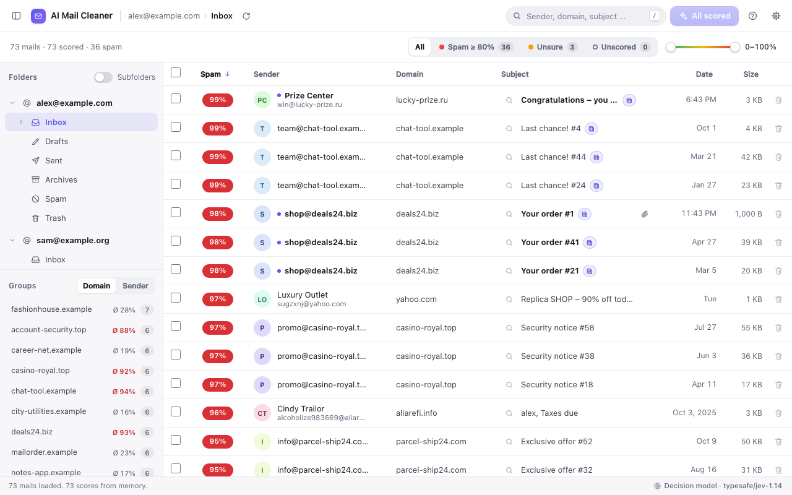
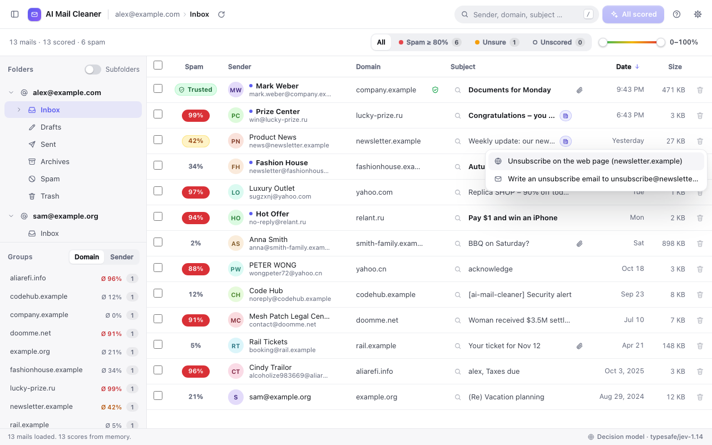
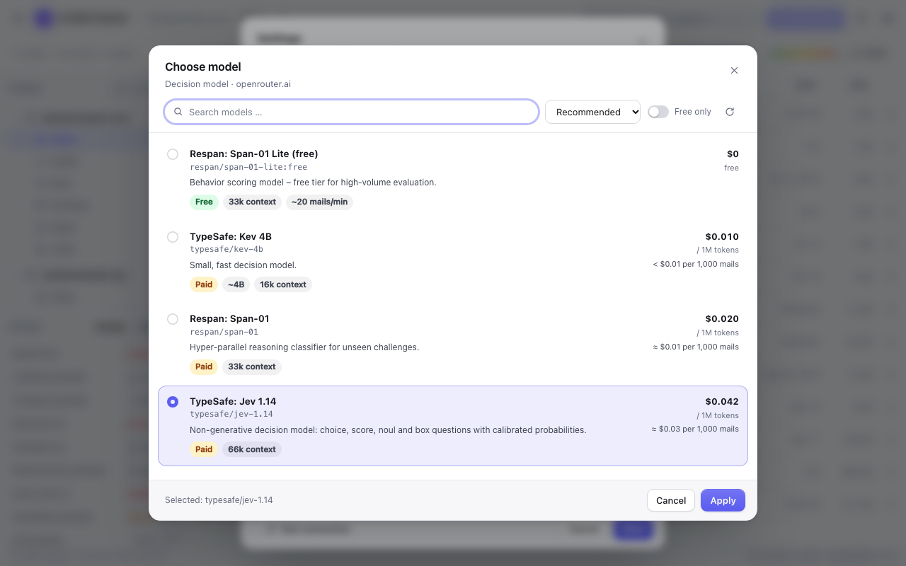
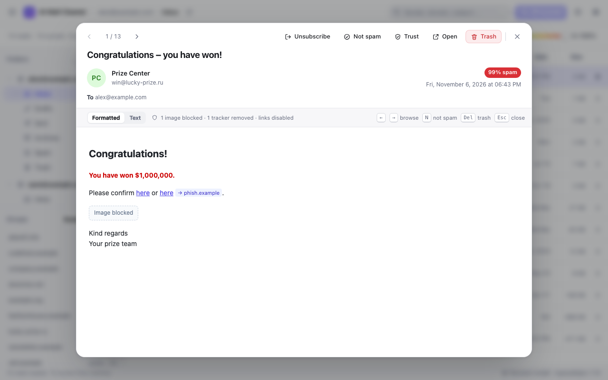

# AI Mail Cleaner

**A Thunderbird add-on for cleaning out mailboxes.** Every mail gets a spam probability from
0 to 100 %, newsletters are recognized and can be unsubscribed from with one click. Group by
domain, filter, and move thousands of mails to the trash in one go – with undo.
No mail composer, just cleaning up.

English · Deutsch · Español – the UI follows Thunderbird's language.



## Features

- **Spam score per mail**, using
  - a **decision model** (default): non-generative classifiers such as *Jev* or *Span-01* via the
    OpenRouter Decisions API – fast, cheap, calibrated probabilities, free model available;
  - any **OpenAI-compatible provider**: OpenRouter, OpenAI, Groq, Mistral, Together, DeepSeek,
    LM Studio or a custom URL – several mails per request;
  - **Ollama (local)**: no key, no cost, no mail leaves your computer.
- **Newsletter detection**: a *Newsletter* tag after the subject (from the `List-Unsubscribe`
  header or an unsubscribe note in the text). Clicking it unsubscribes – it opens the unsubscribe
  page in your browser, or a **ready-made unsubscribe draft** if the newsletter asks for an email.
  For likely spam it warns you first (unsubscribing would only confirm your address).
- **Model picker** with search and sorting, price per 1M tokens, estimated cost per 1,000 mails,
  context length, parameter size, quantization and download size.
- **Scan dialog** before large scans (duration, cost, data sent, “only 50 newest”), progress with
  time left, **stop** at any time. Scores are remembered locally.
- **Filter chips** “Spam ≥ 80 %”, “Unsure”, “Unscored”, a range slider and search.
- **Groups** by domain or sender with the average spam score – select or trash whole groups.
- **Trash with undo**, move to folders (including newly created ones).
- 📎 **Attachment icon**, **safe preview** (sandboxed, no remote images or trackers, link targets
  with phishing hints).
- **Trusted senders/domains**: never spam, never sent anywhere.
- **Large folders** with thousands of mails stay smooth (virtualized table, progressive loading).
- Sortable, reorderable and resizable columns, shift range selection, context menu,
  **keyboard control** (`?` shows all shortcuts), light and dark mode.

| Newsletter & unsubscribe | Model picker | Safe preview |
|---|---|---|
|  |  |  |

## Installation

- **From the catalog** (once published): addons.thunderbird.net → “AI Mail Cleaner”.
- **From a release:** download the `.xpi` from the GitHub releases →
  Thunderbird *Add-ons Manager → gear icon → Install Add-on From File…*
- **For development:** *Menu → Developer Tools → Debug Add-ons → Load Temporary Add-on…* →
  `src/manifest.json`.

Requires Thunderbird **115** or newer.

## Getting started

1. Click the **AI Mail Cleaner** toolbar button (the tab also opens right after installation).
2. **“Set up”** → choose a provider:
   - *Decision model:* enter an [OpenRouter key](https://openrouter.ai/keys). The free model
     `respan/span-01-lite:free` is preselected (~20 mails/min); `typesafe/jev-1.14` is faster.
   - *AI provider:* pick a preset, enter the key, **“Choose model…”**.
   - *Local:* install [Ollama](https://ollama.com), `ollama pull llama3.2:3b`, done.
3. Select a folder on the left → **“Scan N mails”**.
4. Chip **“Spam ≥ 80 %”** → **“Move N spam mails to the trash”** – **Undo** if needed.
5. Newsletters you no longer want: click the **Newsletter** tag (or press `U`).

### Ollama: “403 Forbidden”

Ollama only accepts certain origins by default. If Thunderbird is rejected:

```bash
OLLAMA_ORIGINS='moz-extension://*' ollama serve
```

(On macOS permanently: `launchctl setenv OLLAMA_ORIGINS 'moz-extension://*'`, then restart Ollama.)

## Privacy & security

- Data is sent **only when you scan** and **only to the provider you chose**: sender, subject and,
  optionally, a shortened text excerpt. With Ollama everything stays local. See [PRIVACY.md](PRIVACY.md).
- **Newsletter detection** reads the visible mails from your own mail server – nothing is sent.
  Unsubscribing only happens when you click: the page opens in your browser, or a draft opens
  that you check and send yourself.
- The **API key** is stored only in `storage.local` (not synced) and obfuscated. That is **not real
  encryption** – Thunderbird add-ons have no access to the system keychain. For real protection,
  secure your OS account or set a Thunderbird primary password. Saved keys are never loaded back
  into the input field.
- **Permissions:** only `openrouter.ai` is granted up front. Other providers (including `localhost`)
  are requested individually on first use. `compose` is used only to open unsubscribe drafts.
- **Delete** always moves to the trash (`messages.delete(ids, false)`).
- **HTML preview** in an `<iframe sandbox>` without permissions, with a strict CSP and a sanitizer:
  no scripts, forms, remote images, trackers or navigation.

## Development

```
src/                   the extension (gets packaged)
  manifest.json        manifest (MV2, Thunderbird ≥ 115)
  _locales/            en (default), de, es – generated, see scripts/i18n
  background.js        toolbar button, first start, add-on options → cleaner tab
  icons/               icon (SVG + PNG 16–128)
  ui/cleaner.*         UI: table, dialogs, scan
  ui/ai.js             providers: Decisions API, OpenAI-compatible, Ollama; model list; costs
  ui/newsletter.js     newsletter detection, unsubscribe targets (List-Unsubscribe, text)
  ui/preview.js        safe HTML preview, text extraction
  ui/settings.js       settings, per-provider profiles, key storage, caches
  ui/i18n.js           translations and locale-aware formatting
  ui/icons.js          SVG icon set
dev/mock-messenger.js  mock of the Thunderbird API for the browser preview (not packaged)
scripts/               dev.sh · build.sh · icons.sh · screenshots.sh · i18n/
store/                 store listings (en/de/es) and screenshots (sample data only)
docs/PUBLISHING.md     GitHub releases and addons.thunderbird.net
```

```bash
sh scripts/dev.sh               # browser preview with sample data: http://127.0.0.1:8799/src/ui/_dev.html
                                #   ?n=5000 extra mails · ?fresh=1 first start · ?lang=de|es language
node scripts/i18n/build.mjs     # texts: scripts/i18n/<lang>.mjs → src/_locales (+ completeness check)
sh scripts/build.sh             # → dist/ai-mail-cleaner-<version>.xpi
```

**Translations:** edit `scripts/i18n/en.mjs` (source) and the other languages, then run
`node scripts/i18n/build.mjs` – it fails if a key used in the UI is missing in any language or
if placeholders (`$1`, `$2`) differ. New language: copy `en.mjs`, add the code to `LANGS` in
`build.mjs`. Pull requests welcome.

Publishing: see [docs/PUBLISHING.md](docs/PUBLISHING.md). Changes: [CHANGELOG.md](CHANGELOG.md).

## License

[MIT](LICENSE)
